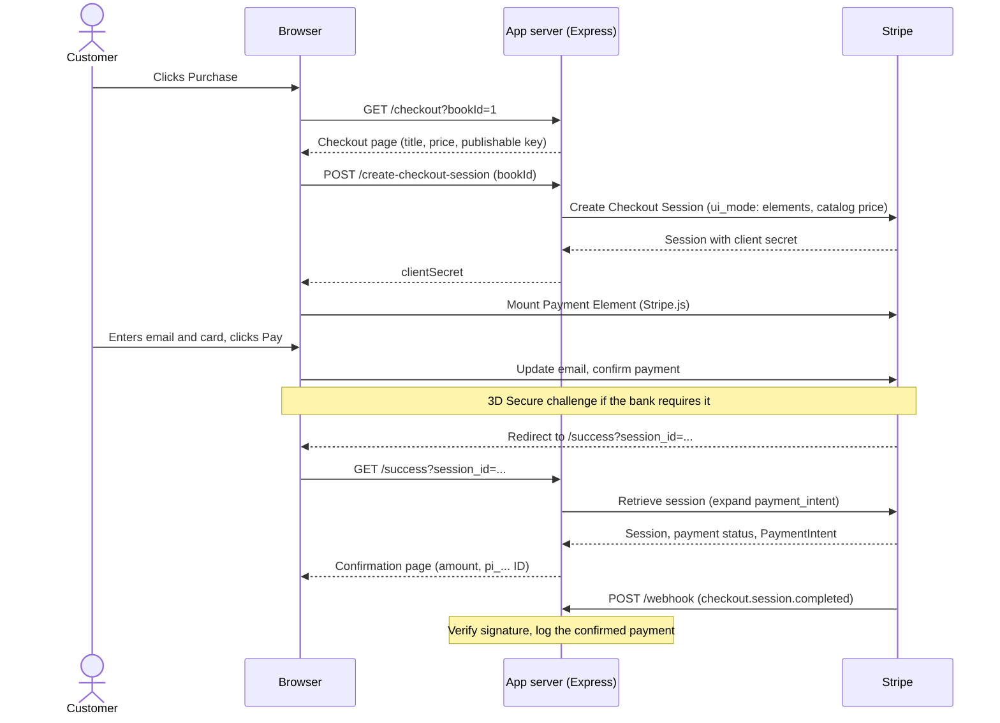

# SA Take-Home Project: BookStripes

By [akira71s](https://github.com/akira71s)

**BookStripes** is an online bookstore built with Node.js and Express. The boilerplate store let customers browse books but had no way to take payments. I added checkout with the **Stripe Payment Element**, embedded directly in the store's own checkout page. After paying, customers see a confirmation with the amount charged and the **Stripe PaymentIntent ID** (`pi_...`).

<p align="center">
  
</p>

**Live demo:** https://akira71s-sa-takehome-project-node.onrender.com/

Pay with test card `4242 4242 4242 4242`, any future expiry date, and any CVC. The demo runs in Stripe test mode, so no real money is charged. It's hosted on Render's free tier and may take up to 30 seconds to wake up on the first visit.

Webhooks aren't enabled on the live demo. To see them in action, run the app locally with the Stripe CLI (see [Receive webhooks](#4-receive-webhooks-optional)).

## Contents

- [How to run the app](#how-to-run-the-app)
- [How to make a test payment](#how-to-make-a-test-payment)
- [Architecture](#architecture)
- [Key design decisions](#key-design-decisions)
- [Docs](#docs)
- [Challenges](#challenges)
- [Extending the app](#extending-the-app)

## How to run the app

### Prerequisites

- [Node.js](https://nodejs.org/) 22.22 or later (`node -v` to check)
- A Stripe account for [your own test keys](#2-configure-your-stripe-keys). A free account is enough: [sign up here](https://dashboard.stripe.com/register).

### 1. Install

```bash
git clone https://github.com/akira71s/sa-takehome-project-node
cd sa-takehome-project-node
npm install
```

### 2. Configure your Stripe keys

Copy the sample environment file:

```bash
cp sample.env .env
```

Then open `.env` and paste in your **test-mode** keys from the [API keys page](https://dashboard.stripe.com/test/apikeys) in the Stripe Dashboard:

| Variable | Starts with | Where it's used |
|---|---|---|
| `STRIPE_SECRET_KEY` | `sk_test_` | Server only. Never share or commit it. |
| `STRIPE_PUBLISHABLE_KEY` | `pk_test_` | Sent to the browser to initialize Stripe.js. |

The app checks your keys when it starts. If a key is missing or empty, the two keys are swapped, or you've pasted live keys instead of test keys, it stops and tells you exactly what to fix.

### 3. Run

```bash
npm start
```

Then open [http://localhost:3000](http://localhost:3000).

During development, use `npm run dev` instead. It restarts the server automatically when you edit a server-side file.

### 4. Receive webhooks (optional)

The app runs without webhooks, but they let the server confirm orders even if the customer closes the tab before the confirmation page loads. To receive them locally, install the [Stripe CLI](https://docs.stripe.com/stripe-cli) and run it in a second terminal:

```bash
stripe login
stripe listen --events checkout.session.completed,checkout.session.async_payment_succeeded,checkout.session.async_payment_failed --forward-to localhost:3000/webhook
```

Copy the `whsec_...` signing secret it prints into `.env` as `STRIPE_WEBHOOK_SECRET`, then restart the app. After a test payment, the Stripe CLI shows the event and the app's `200` response:

```text
2026-11-17 02:16:58   --> checkout.session.completed [evt_1UcTWZEE7XEQE1a6fQJAAOUX]
2026-11-17 02:16:58  <--  [200] POST http://localhost:3000/webhook [evt_1UcTWZEE7XEQE1a6fQJAAOUX]
```

The server log shows `Payment confirmed for Checkout Session cs_test_...`.

When deployed, register `https://<your-host>/webhook` as a webhook endpoint in the Stripe Dashboard with the same three events, and set that endpoint's signing secret as `STRIPE_WEBHOOK_SECRET` on the host.

## How to make a test payment

Use the [live demo](https://akira71s-sa-takehome-project-node.onrender.com/) or a local copy at http://localhost:3000. To run it locally, follow [How to run the app](#how-to-run-the-app).

1. Pick a book and click **Purchase**.

   

2. Enter any email address.
3. Pay with test card `4242 4242 4242 4242`, any future expiry date, and any CVC.

   

4. The confirmation page shows the amount charged and the PaymentIntent ID (`pi_...`).

   

### Other test cards to try

Use any future expiry date and any CVC. Stripe's [testing docs](https://docs.stripe.com/testing) list many more scenarios.

| Card number | What happens |
|---|---|
| `4000 0025 0000 3155` | Asks for 3D Secure authentication. Click **Complete** in the pop-up to finish the payment, or **Fail** to see how a failed authentication is handled. <br>  |
| `4000 0000 0000 0002` | Declined. The error appears under the payment form, and you can try again. <br>  |
| `4000 0000 0000 9995` | Declined for insufficient funds. <br>  |

### Find the payment in the Stripe Dashboard

1. Copy the PaymentIntent ID from the confirmation page with the **Copy** button.
2. Open the [Payments (Transactions) page](https://dashboard.stripe.com/test/payments) in the Stripe Dashboard, in test mode.

   

3. Paste the `pi_...` ID into the search bar at the top.
4. Open the payment. It shows the same amount, the book's name as the line item, and the customer's email.

   

## Architecture

### Payment flow

1. **Pick a book.** The customer clicks **Purchase** on the store page, which opens `/checkout?bookId=…`.
2. **Show the payment form.** The server creates a Checkout Session at the book's catalog price, and Stripe.js mounts the Payment Element with the session's client secret.
3. **Pay.** The customer enters their email and card details and clicks **Pay**. Card details go straight to Stripe, never through the app's server, and Stripe handles 3D Secure if the bank requires it.
4. **See the confirmation.** Stripe redirects to `/success`, where the server looks up the payment and shows the book, the amount charged, and the PaymentIntent ID.
5. **Confirm via webhook.** Stripe also sends a `checkout.session.completed` webhook. The server verifies its signature and records that the payment is confirmed, even if the customer never reaches `/success`.

If a payment fails, the customer sees the error under the form and can try again. If a payment method takes time to confirm, the confirmation page shows "Payment processing", and refreshing it later shows the result.



### Stripe APIs used

| API | Where | Purpose |
|---|---|---|
| [Checkout Sessions API](https://docs.stripe.com/api/checkout/sessions) (`ui_mode: 'elements'`) | Server | Create the session with the book's price (`create`); get the payment result on the confirmation page (`retrieve`) |
| [Payment Element](https://docs.stripe.com/payments/payment-element) via [Stripe.js](https://docs.stripe.com/js/custom_checkout) | Browser | Collect payment details, add the customer's email, and confirm the payment |
| [Webhooks](https://docs.stripe.com/webhooks) | Server | Receive `checkout.session.*` events and verify their signatures |

The PaymentIntent ID comes from the Checkout Session: the server expands `payment_intent` when it retrieves the session, so the app never calls the Payment Intents API directly.

### File structure

```
├── app.js
├── config.js
├── books.js
├── sample.env
├── views/
│   ├── layouts/main.hbs
│   ├── index.hbs
│   ├── checkout.hbs
│   ├── success.hbs
│   └── error.hbs
└── public/
    ├── js/
    │   ├── checkout.js
    │   └── format-amounts.js
    ├── css/custom.css
    └── images/
```

**Server-side (Node.js)**

| File | What it does |
|---|---|
| [`app.js`](app.js) | Express server: routes, Stripe API calls, webhooks, error handling |
| [`config.js`](config.js) | Loads `.env` and checks the Stripe keys and webhook secret at startup |
| [`books.js`](books.js) | Book catalog (title, author, price, cover) and lookup by ID |
| [`sample.env`](sample.env) | Template for `.env` |

**Pages (Handlebars templates, rendered on the server)**

| File | Page |
|---|---|
| [`views/layouts/main.hbs`](views/layouts/main.hbs) | Shared layout; loads Stripe.js |
| [`views/index.hbs`](views/index.hbs) | Store page, built from the catalog |
| [`views/checkout.hbs`](views/checkout.hbs) | Checkout page with the Payment Element |
| [`views/success.hbs`](views/success.hbs) | Confirmation with the amount and PaymentIntent ID |
| [`views/error.hbs`](views/error.hbs) | Friendly error page |

**Client-side (browser)**

| File | What it does |
|---|---|
| [`public/js/checkout.js`](public/js/checkout.js) | Mounts the Payment Element and confirms the payment |
| [`public/js/format-amounts.js`](public/js/format-amounts.js) | Shows prices in dollars instead of cents (renamed from `custom.js`) |
| [`public/css/custom.css`](public/css/custom.css) | Styles |

## Key design decisions

### Checkout Sessions API vs Payment Intents API

The Payment Element works with two server-side APIs: the [Payment Intents API](https://docs.stripe.com/api/payment_intents) and the [Checkout Sessions API](https://docs.stripe.com/api/checkout/sessions). The Payment Intents API gives more room to customize, because you build the checkout logic yourself. I chose the Checkout Sessions API because Stripe [recommends it](https://docs.stripe.com/payments/payment-element#compatible-apis) unless you need that level of customization.

Despite the name, this isn't the hosted Stripe Checkout page. The session is created with `ui_mode: 'elements'`, which embeds the Payment Element in the app's own checkout page.

### Payment Element layout: `accordion`

The Payment Element can list payment methods as tabs or as an accordion. Stripe's [best practices](https://docs.stripe.com/payments/payment-element/best-practices) suggest choosing the layout that fits your site and confirming it with an A/B test, which is what I'd do for a real store.

For this assignment, I used the `accordion` layout because it's Stripe's default. Stripe [switched the default from tabs to accordion in 2025](https://docs.stripe.com/changelog/basil/2025-03-31/default-layout-of-payment-element), noting that it can improve conversion on mobile, and I assume a default like that is backed by real-world data. I also turned on radio buttons so it's always clear which method is selected.

### One source for prices

The boilerplate defined prices twice, once in `app.js` and once on the store page, and its history shows they once drifted apart. Now `books.js` is the only place prices live: the store page is rendered from it, and the server looks up the price from it when creating the Checkout Session. The browser only sends a book ID, so it can't change what a customer is charged.

### Confirmation page: one server-rendered route

Stripe's [quickstart](https://docs.stripe.com/payments/quickstart) splits the confirmation into a static `/complete` page and a `/session-status` endpoint that the page's JavaScript calls for the payment result.

Because this app renders its pages on the server, I combined both into a single `/success` route. The server retrieves the Checkout Session and renders the page with the result already in it: one less endpoint, no client-side fetch, and no loading state. In a single-page app (for example, built with React), I'd follow the quickstart's approach instead.

### Webhooks for payment events

The `/webhook` endpoint verifies each event's signature and logs confirmed and failed payments. It's the place where a production store would update its order database and start fulfillment, marked with `TODO` comments in the code. I kept this demo deliberately simple: with no database, tracking orders in memory would look like real fulfillment without being reliable. In production I'd follow Stripe's [fulfillment guide](https://docs.stripe.com/checkout/fulfillment): fulfill from both the webhook and the confirmation page, whichever comes first, and record each order once.

### Configuration mistakes fail early

`config.js` runs before anything else and checks that both Stripe keys are set and look right. They can come from a local `.env` file or, when deployed, from the host's environment variables. Missing keys, swapped keys, or live keys stop the app at startup with a clear message, instead of surfacing later as a confusing error in the middle of a payment.

### Errors never show internals

An unknown book, an invalid session ID, or a failed Stripe API call leads to a friendly message or a redirect. Details are logged on the server, never shown in the browser.

## Docs

**Building it**
- [Payment Element overview](https://docs.stripe.com/payments/payment-element): what the Payment Element is and which APIs it works with
  - [Payment Element best practices](https://docs.stripe.com/payments/payment-element/best-practices): layout choice and error handling
- [Compare the Checkout Sessions and Payment Intents APIs](https://docs.stripe.com/payments/checkout-sessions-and-payment-intents-comparison): why I chose Checkout Sessions over the Payment Intents API
- [Payments quickstart (Checkout Sessions + Payment Element)](https://docs.stripe.com/payments/quickstart): the starting point for the overall flow
- [Payment line items](https://docs.stripe.com/payments/payment-line-items): setting each book's price with `price_data`

**Webhooks**
- [Receive Stripe events in your webhook endpoint](https://docs.stripe.com/webhooks): setting up the `/webhook` endpoint and registering it in the Dashboard
- [Verify webhook signatures](https://docs.stripe.com/webhooks/signature): why signature checks need the raw request body
- [Fulfill orders](https://docs.stripe.com/checkout/fulfillment): which `checkout.session.*` events to handle, and the production design noted in the code's `TODO`s
- [Stripe CLI](https://docs.stripe.com/stripe-cli): forwarding events to `localhost` with `stripe listen`

**API references**
- [Create a Checkout Session](https://docs.stripe.com/api/checkout/sessions/create): server-side parameters such as `ui_mode` and `return_url`
- [The Checkout Session object](https://docs.stripe.com/api/checkout/sessions/object): `client_secret`, `payment_status`, and expanding `payment_intent`
- [Elements with the Checkout Sessions API (Stripe.js)](https://docs.stripe.com/js/custom_checkout): `initCheckoutElementsSdk()`, `createPaymentElement()`, `loadActions()`

**Testing**
- [Testing](https://docs.stripe.com/testing): test cards, including 3D Secure and declines

**Node.js**
- [`process.loadEnvFile()`](https://nodejs.org/api/process.html#processloadenvfilepath): loading `.env` without the `dotenv` package

## Challenges

### Can a session client "secret" be sent to the browser?

The [quickstart](https://docs.stripe.com/payments/quickstart?client=html)'s server sends the session's client secret to the browser:

```javascript
const session = await stripe.checkout.sessions.create({ ui_mode: "elements", /* ... */ });
res.send({ clientSecret: session.client_secret });
```

Because the name includes **"secret"**, I wasn't sure this was safe at first, since the secret key must never leave the server. The [Checkout Session object reference](https://docs.stripe.com/api/checkout/sessions/object#checkout_session_object-client_secret) cleared it up: for `ui_mode: elements`, the client secret is meant to be used on the front end.

| | Secret key (`sk_test_...`) | Checkout Session client secret |
|---|---|---|
| Scope | The whole Stripe account | One Checkout Session |
| What it allows | Almost anything, such as charges, refunds, and customer data (unless [restricted](https://docs.stripe.com/keys/restricted-api-keys)) | Only completing that one session |
| Can it change the price? | Yes | No. The amount is fixed when the server creates the session. |

So the worst someone could do with a client secret is pay for that book at the correct price. It still needs care: the app doesn't log or store it, sends it only to the customer who started the checkout, and in production the page would be served over HTTPS.

### Bringing an outdated boilerplate up to date

The boilerplate was last updated in September 2021, about five years ago, and its JavaScript, CSS, and npm packages were all out of date. I modernized them before building the payment flow. Keeping packages on supported versions matters most for security: old versions stop receiving fixes for known vulnerabilities, a risk no store that handles payments should take.

**JavaScript.** I replaced `var` (e.g. [app.js](https://github.com/mattmitchell6/sa-takehome-project-node/blob/master/app.js#L7)) with `const` and `let`, which are block-scoped and make it clear which values are meant to change. 

**CSS and layout.**

- I removed the `-webkit-` and `-moz-` prefixed `box-shadow` rules (e.g. [custom.css](https://github.com/mattmitchell6/sa-takehome-project-node/blob/master/public/css/custom.css#L9-L10)). Every browser that runs Stripe.js today supports plain `box-shadow`.
- I added the `viewport` meta tag. Without it, phones show a shrunken desktop layout and Bootstrap's responsive grid doesn't take effect.

**npm packages.**

| Package | Before | After | Notes |
|---|---|---|---|
| `stripe` | `^8.137.0` | `^23.1.0` | Latest as of November 16, 2026 ([npm](https://www.npmjs.com/package/stripe)). Checkout Sessions with `ui_mode: 'elements'` needs a current SDK. |
| `express` | 4 | 5 | Express 5 forwards errors thrown in `async` route handlers, which matters for routes that call the Stripe API. |
| `express-handlebars` | 5 | 9 | Version 6 and later export `engine` instead of a function, so I updated the setup in `app.js`. |
| `path` | `^0.12.7` | removed | An old browser polyfill. The app uses Node's built-in module, `require('node:path')`. |
| `dotenv` | `^10.0.0` | removed | Node 21.7.0 and later load `.env` files natively with [`process.loadEnvFile()`](https://nodejs.org/en/blog/release/v21.7.0#loading-and-parsing-environment-variables). |

```bash
npm install stripe@latest express@latest express-handlebars@latest
npm uninstall path dotenv
```

**Node.js version.** express-handlebars 9 requires Node.js 22.22 or later. That's a reasonable minimum anyway: Node 20 and earlier have reached end of life, and Node 22 is the oldest line still receiving security fixes ([release schedule](https://nodejs.org/en/about/previous-releases)). I added `"engines": { "node": ">=22.22" }` to `package.json`, so `npm install` on an older version shows a warning instead of failing with a confusing error later.

## Extending the app

This app covers the core purchase flow. Because it uses Checkout Sessions, much of what a real store needs is a few extra parameters rather than new logic. Roughly in order of priority:

### Reliable order fulfillment

- **An orders database, updated by webhooks.** The app doesn't store orders yet; the webhook only logs confirmed payments. A database would store each order with its Checkout Session and PaymentIntent IDs, make sure each order is fulfilled only once, and support order history, refunds, and customer support. Webhooks should be what keeps it up to date: the browser can close at any time, and some changes never involve the customer at all, such as a delayed payment failing (`checkout.session.async_payment_failed`), a refund issued from the Dashboard (`charge.refunded`), or a dispute (`charge.dispute.created`). Each webhook would update the matching order, with the stored event ID used to skip events that arrive more than once.
- **A job queue for fulfillment.** Once fulfillment does real work, like sending emails or creating shipments, the webhook should respond to Stripe immediately and hand that work to a background queue.

### Payments

- **Express Checkout Element.** One-click Apple Pay, Google Pay, and Link buttons, especially useful on mobile.
- **Tax, discounts, and shipping.** Stripe Tax, promotion codes, and shipping rates are all built into Checkout Sessions.
- **Adaptive Pricing.** Local-currency prices for international customers, available only with Checkout Sessions.

### Store features

- **A cart.** Checkout Sessions accepts multiple line items with quantities.
- **[Product Catalog](https://docs.stripe.com/products-prices/manage-prices).** Change prices in the Dashboard instead of editing and redeploying `books.js`.
- **Saved customers.** Stripe Customers with saved payment methods make repeat purchases faster.
- **A branded payment form.** Style the Payment Element with the [Appearance API](https://docs.stripe.com/elements/appearance-api) to match the store instead of using the default `stripe` theme.

### Production readiness

- **Least-privilege secrets.** Keep keys in a secret manager and use a [restricted key](https://docs.stripe.com/keys/restricted-api-keys) with only the permissions the app needs.
- **Idempotency and logging.** [Idempotency keys](https://docs.stripe.com/api/idempotent_requests) so a retried request never creates a duplicate, and logs for failed Stripe API calls.
- **Tests and CI.** Run route and startup tests on every pull request.

### Payment Intents API for customization

I'd switch to the [Payment Intents API](https://docs.stripe.com/api/payment_intents) if the store already had its own order system that calculates totals, tax, and discounts, or needed a flow Checkout Sessions doesn't support, such as confirming the payment on the server after custom checks. Customers would see the same Payment Element, but the server would create PaymentIntents instead of Checkout Sessions, and the browser code would use `stripe.elements()` and `stripe.confirmPayment()` to set it up and confirm.
